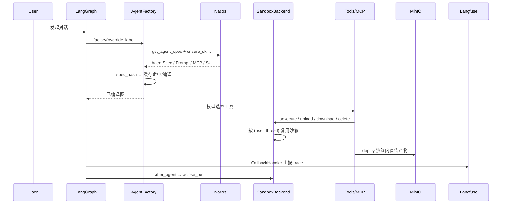

# Mentor 项目开发指南

> 面向开发者的项目说明：代码结构、请求链路、配置分层、沙箱生命周期、测试与发布。
> 基础设施与端口拓扑见 [architecture.md](architecture.md)。

## 1. 项目定位

Mentor 是一个基于 **LangGraph / DeepAgents** 的 Agent 服务：

- **Nacos**：AgentSpec、Prompt、MCP、Skill、`sandbox_config` 的运行时控制面；
- **LiteLLM**：统一模型网关，Agent 不直接持有厂商密钥；
- **OpenSandbox**：隔离执行环境，按用户持久化 `/root`，共享只读 `/shared`；
- **MinIO**：保存运行时文件与交付产物；
- **Langfuse**：Trace、Dataset、Experiment 与告警。

## 2. 快速开始

```bash
# 1. 准备配置
cp .env.example .env

# 2. 启动基础设施
make docker-recreate

# 3. 首次使用/修改 Dockerfile 后构建沙箱镜像
docker build -t opensandbox-python-node:1.0 -f docker/sandbox/Dockerfile .

# 4. 启动前体检（Nacos、AgentSpec、模型网关、MinIO、sandbox_config）
uv run mentor config doctor
# 或：make dev-check（先 doctor 再启动）

# 5. 启动 Agent
make dev
```

常用检查：

```bash
uv run mentor config schema
uv run mentor config validate --file path/to/agent_spec.json
uv run mentor config validate --agent main_agent
make test-units
```

## 3. 代码结构

```text
src/mentor/
├─ agents/
│  ├─ agent_factory.py        # Nacos 规格 → 模型/工具/子 Agent/图；spec_hash 缓存
│  ├─ agent_cache.py          # (agent, spec_hash) LRU；每 Agent 默认 3 个版本
│  ├─ subagent_registry.py    # @register_subagent 注册表
│  ├─ main.py                 # 主 Agent：MainAgentState + turn_summary
│  └─ web.py                  # web_agent 子 Agent
├─ backends/
│  └─ sandbox_backend.py      # 文件/命令/删除 → OpenSandbox；run 级连接缓存
├─ config/
│  ├─ layers.py               # 四层配置合并 + AgentSpecOverride
│  ├─ errors.py               # ConfigNotFound / ConfigUnavailable
│  ├─ doctor.py               # 启动前配置体检
│  ├─ nacos/                  # AgentSpec / Prompt / MCP / Skill / 通用配置
│  └─ *_settings.py           # pydantic-settings（.env）
├─ middlewares/
│  ├─ turn_summary.py         # 前端可见消息摘要
│  ├─ sandbox_lifecycle.py    # after_agent 关闭当前 run 的沙箱连接
│  └─ tool_executor.py        # 所有工具调用接入统一执行器
├─ security/auth.py           # LangGraph 鉴权（当前为 MOCK_USER）
├─ tools/
│  ├─ specs.py                # ToolSpec / @register_tool / 风险与暴露级别
│  ├─ executor.py             # 限时、错误分类、截断落盘、结果信封
│  ├─ artifacts.py            # artifact:// 存储与读取
│  └─ *.py                    # deploy / web / time / ask_user_question
├─ benchmarks/                # Langfuse Dataset / Experiment / 评测器
├─ app/                       # 自定义 Webhook 路由
└─ utils/                     # 模型、缓存、MinIO、沙箱、trace 等通用工具
```

## 4. 请求链路



要点：

- `AgentFactory` 按 `(agent_name, spec_hash)` 缓存图；Prompt/模型/MCP/工具/子 Agent 变化会生成新 hash。
- 子 Agent 规格参与主 Agent 的 hash，子 Agent 更新会触发主图重建。
- `spec_hash` 写入图 metadata，并随 trace 进入 Langfuse。
- `x-litellm-session-id` 由 `ReasoningChatModel` 每次请求注入，图缓存不会固定首个 thread 的 header。

### 4.1 工具执行链

```text
Agent 工具调用
  → ToolExecutorMiddleware
    → ToolSpec（risk / exposure / timeout_s / max_output_chars）
      → ToolExecutor
        → 内置工具 / 业务工具 / MCP 工具
          → ToolMessage.content（预览）
          → ToolMessage.artifact（{ok,data,error_kind,truncated,artifacts,duration_ms}）
```

- 业务工具实现后用一行 `@register_tool(risk=..., timeout_s=...)` 登记；Nacos AgentSpec 的 `tools` 白名单决定是否装配。
- 所有工具（含 DeepAgents 内置、MCP、业务）都经过同一个中间件：限时 → 执行 → 截断/落盘 → 错误分类。
- 错误分类：`input`（模型可修复）、`policy`（策略拒绝）、`timeout`、`system`（终止 run）。
- 超过 `max_output_chars`（默认 8000）的输出落到 `TOOL_ARTIFACT_DIR`，`content` 返回预览，`artifacts` 返回 `artifact://`；`read_artifact` 自动可用。
- MCP 默认 `deferred`：不直接进 prompt，模型先 `tool_search`，再 `call_tool(name, arguments)`；如要旧行为，把 server 配成 `exposure: direct`。
- MCP server 可声明 `auth`、`timeout_seconds`、`allowed_tools`、`exposure`、`risk`；`auth` 建议从密钥管理注入，不要提交到仓库。

## 5. 配置分层与灰度

```text
Pydantic defaults  <  .env  <  Nacos AgentSpec  <  request override
```

| 层 | 来源 | 说明 |
|---|---|---|
| defaults | Pydantic 字段默认值 | 最小可运行配置 |
| `.env` | `BaseSettingsWithEnv` | 地址、密钥、TTL、label |
| Nacos | AgentSpec / Prompt / `sandbox_config` | 运行时主配置 |
| request override | `configurable.agent_spec_override` | 单次 run 临时覆盖，不写回 Nacos |

请求级覆盖示例：

```json
{
  "configurable": {
    "agent_label": "staging",
    "agent_spec_override": {
      "system_prompt": "本次使用精简提示",
      "model": { "temperature": 0.2 }
    }
  }
}
```

边界：

- `NACOS_LABEL` 支持 `production` / `staging`；AgentSpec 和 Prompt 跟随 label。
- MCP 是 Nacos 管理端全局配置，不随 label 切换。
- Skill 下载仍固定 `production`；staging 技能需要后续把 label 纳入技能存储路径。

配置体检：

```bash
uv run mentor config doctor
```

检查 Nacos AgentSpec、必填字段、模型网关 `/models`、MinIO 桶、`sandbox_config`。任一项失败返回非 0。

## 6. 沙箱生命周期

```text
SandboxBackend._get_or_create_sandbox
  key = (user_id, thread_id)
  ├─ 命中进程内缓存 → 更新 last_used_at，直接返回
  └─ 未命中 → per-key lock → get_sandbox(user_id) → OpenSandbox.connect/create
       └─ 写入缓存

Agent 结束 → sandbox_lifecycle after_agent → aclose_run
命令通道异常 → aexecute 丢弃当前连接
deploy 自建 backend → finally aclose_run
```

- **PVC**：`<tenant>-<sha256(user_id)[:12]>`；`/root` 持久，`/shared` 只读共享。
- **严格 Store**：生产禁止 `InMemoryStore` 回落；本地脚本需显式 `OPEN_SANDBOX_ALLOW_MEMORY_STORE=true`。
- **资源/网络**：`sandbox_config` 可配 `cpu`、`memory`、`network_default_action`、`network_allow`；未配置时用 OpenSandbox 默认值。
- **空闲回收**：进程内缓存按 `OPEN_SANDBOX_IDLE_TIMEOUT_SECONDS`（默认 1800 秒）回收；0 表示交给 OpenSandbox TTL。
- **删除安全**：只允许 `/root` 下路径；父目录 realpath 解析后再做前缀检查；走文件 API，不拼接 shell。
- **迁移注意**：PVC 名变化后旧 `/root` 数据不会自动挂载，需要保留旧 PVC 或复制数据。

## 7. 关键环境变量

| 变量 | 作用 |
|---|---|
| `NACOS_SERVER_ADDRESS` / `NACOS_NAMESPACE_ID` | Nacos 地址与命名空间 |
| `NACOS_TTL` | 配置本地缓存秒数，建议 5 |
| `NACOS_LABEL` | `production` / `staging` |
| `MINIO_*` | MinIO 地址、凭据、桶名、预签名有效期 |
| `OPENAI_BASE_URL` / `OPENAI_API_KEY` | LiteLLM 网关地址与鉴权 |
| `OPEN_SANDBOX_DOMAIN` / `OPEN_SANDBOX_API_KEY` | OpenSandbox Server |
| `OPEN_SANDBOX_TENANT` | PVC 名称前缀 |
| `OPEN_SANDBOX_ALLOW_MEMORY_STORE` | 仅本地脚本设为 true |
| `OPEN_SANDBOX_IDLE_TIMEOUT_SECONDS` | 空闲连接回收时间 |
| `LANGFUSE_*` | Trace / Dataset / Webhook |
| `TOOL_ARTIFACT_DIR` | 工具超长输出落盘目录，默认 `/tmp/mentor-tool-artifacts`；生产建议挂持久卷并限制权限 |

## 8. 测试与发布

```bash
# 静态检查
.venv/bin/pyright --pythonpath .venv/bin/python src tests resource

# 单元测试
.venv/bin/pytest -q tests/units

# 部署集成（需要真实 MinIO / OpenSandbox）
MINIO_INTEGRATION=1 DEPLOY_INTEGRATION=1 \
DEPLOY_SANDBOX_IMAGE=opensandbox-python-node:1.0 \
.venv/bin/pytest -q tests/intergrations/test_deploy.py
```

发布：

1. 重新构建包含 `mentor` CLI 的镜像（`[project.scripts]`）。
2. 运行 `mentor config doctor` / `make dev-check`。
3. 灰度时先在 Nacos 发布 `staging` AgentSpec + Prompt，再切 `NACOS_LABEL=staging`。
4. 回滚优先改 Nacos label/版本；进程内可用 `AgentFactory.rollback(spec_hash)` 回到仍缓存的历史 hash。

## 9. 已知限制

- `MOCK_USER` 明文 token，仅适合本地；生产需 OIDC/JWT。
- MCP 为全局配置，Skill 固定 production，staging 只覆盖 AgentSpec/Prompt。
- Agent 编译缓存与沙箱缓存都是进程内缓存，多 worker 不共享。
- 目录部署是「先清空、再上传」，不是原子替换。
- OpenSandbox 依赖宿主 Docker socket，多租户生产应换成独立沙箱集群/microVM。
- `SandboxBackend` 同步接口仍用 `asyncio.run`；事件循环内请使用异步方法。
- `TOOL_ARTIFACT_DIR` 是进程本地目录，多 worker 不共享；生产需挂持久卷/共享存储，并限制目录权限。
- MCP 默认 `deferred`，模型需要先调用 `tool_search` 再 `call_tool`；如果 MCP 工具必须直接暴露，在 server 配置里设 `exposure: direct`。
- `ToolMessage.artifact` 保存结构化信封，`content` 是预览；依赖原始 `content` 的旧工具/前端需要适配。
- MCP `auth` 会进入 Nacos 配置，属于敏感信息；生产应从密钥管理注入，不要写进 Git。

## 10. 上线前：多账号 / 多租户

当前**不能直接上线多账号**：登录仍是 `MOCK_USER`，Assistants 缺 owner 过滤，MinIO 把桶级凭据放进沙箱，LiteLLM 没有账号级配额，且没有 tenant 模型。

完整 P0/P1/P2 改造清单、风险矩阵、双用户验收用例与 Go/No-Go 条件见：

- [多账号 / 多租户上线改造清单](multi-account-hardening.md)

上线前至少完成 P0-1 ~ P0-6，并通过双用户越权 E2E。
